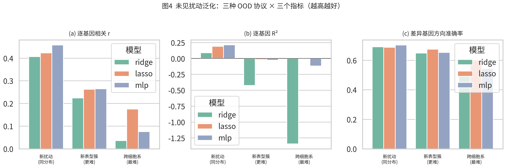
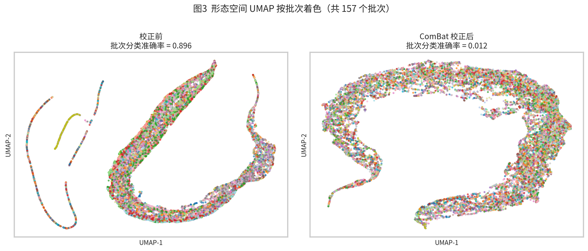
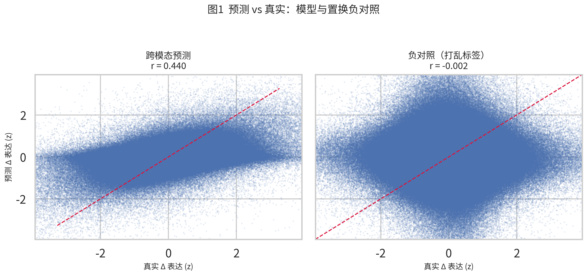
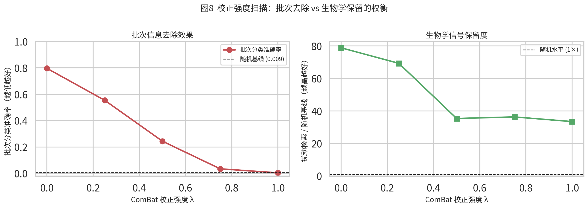

# morph2expr-agents

**Predicting transcriptional responses from Cell Painting morphology with a 7-agent deterministic pipeline.**

[中文说明](README.zh-CN.md) · [方法与实验说明](方法与实验说明.md) · [结果摘要](结果摘要.md) · [报告与PPT大纲](报告与PPT大纲.md)

---

## What this is

A single perturbation (a drug, an shRNA knockdown, an over-expressed gene) leaves traces in **two
readouts** of the same cell: what it *looks like* (Cell Painting morphology) and what it *expresses*
(L1000 transcriptome). This repo learns the map

$$f: X_{\text{morph}} \in \mathbb{R}^{399} \;\longrightarrow\; Y_{\text{expr}} \in \mathbb{R}^{978}$$

and — the part that actually matters — evaluates it on **perturbations never seen during training**.

Everything is a deterministic Python script with a fixed seed. No LLM touches the numbers, so
`bash scripts/run_all.sh` reproduces the same figures and tables bit-for-bit.

## Headline results

**Data** — 3 paired subsets from the Broad *Rosetta* dataset, **1,861 matched perturbations**,
399 shared morphology features, 978 landmark genes.

| Subset | Cell line | Perturbation | Matched |
|---|---|---|---|
| `LINCS-Pilot1` | A549 | compound | 1230 |
| `TA-ORF-BBBC037-Rohban` | U2OS | ORF over-expression | 117 |
| `LUAD-BBBC041-Caicedo` | A549 | shRNA + ORF | 514 |

**Cross-modal prediction** (per-gene Pearson *r*, mean; permutation null ≈ −0.01)

| Evaluation protocol | Ridge | Lasso | MLP | DGE direction acc. |
|---|---|---|---|---|
| `perturbation_kfold` — unseen perturbations | 0.406 | 0.423 | **0.458** | 0.704 |
| `cluster_kfold` — unseen phenotype clusters | 0.224 | 0.263 | 0.265 | 0.654 |
| `cross_dataset` — seen cell line → new subset | 0.036 | 0.175 | 0.076 | 0.544 |

**Batch effects** (157 plates) — batch accuracy collapses to chance while perturbation
retrievability stays ~62× above chance:

| Metric | Before | After ComBat | Chance |
|---|---|---|---|
| Batch classifier accuracy (**lower is better**) | 0.896 | **0.012** | 0.008 |
| Perturbation retrieval @1 (higher is better) | 0.0386 (111×) | 0.0217 (62×) | 0.00035 |

**Over-correction is real** — sweeping the correction strength λ from 0 → 1 drives batch accuracy
0.796 → 0.004, but perturbation retrievability simultaneously drops from **79× to 33×** above chance.
Correction strength is a knob, not a constant.

**Causal stratification** — genetic perturbations, which are single-point and attributable, are
noticeably more predictable than poly-pharmacological compounds:

| Perturbation type | n | per-gene *r* | per-gene R² |
|---|---|---|---|
| compound | 1230 | 0.271 | 0.068 |
| ORF over-expression | 543 | **0.405** | 0.178 |
| shRNA knockdown | 88 | **0.435** | 0.196 |

## Figures

| | |
|---|---|
|  |  |
| **fig4** — performance degrades monotonically as the distribution shift grows | **fig3** — UMAP by plate; after ComBat the batches are fully mixed |
|  |  |
| **fig1** — prediction vs truth, next to a permuted-label null | **fig8** — the batch-removal / biology-retention trade-off |

## Quick start

```bash
# 1) environment
python -m venv --system-site-packages .venv
.venv/bin/python -m pip install -r requirements.txt

# 2) download the paired data (~600 MB, 3 subsets)
.venv/bin/python scripts/00_download.py

# 3) run everything (build → batch → predict → validate → figures → sweep → summary)
bash scripts/run_all.sh --no-download
```

Outputs land in `results/figures/` (9 figures), `results/tables/`, `results/metrics/`, and a
fully-numbered `结果摘要.md`. Runtime ≈ 25 min on CPU; no GPU needed.

Single stages:

```bash
.venv/bin/python scripts/run_pipeline.py --stage build|batch|predict|validate|figures
```

## Architecture

Seven agents, chained by dependencies. Each one is a module in `src/bioinfo_wam/`.

```
Cell Painting ──► ① QC ──► ② Morphology ──► X_morph ─┐
   (1783 feats)    blocklist   within-plate z        │
                   variance    replicate→pert mean   │
                   correlation                        ├──► ⑤ Prediction ──► OOD metrics
L1000 ──────────► ③ Transcriptomics ──► Y_expr ──────┤    Ridge/Lasso/MLP    + null control
   (978 genes)     Δ vs control   robust z           │    3 protocols
                   replicate consistency             │
Perturbations ──► ④ Encoding ──► structure/gene vec ┘
                   Morgan FP · gene SVD · type       ▼
                                              ⑥ Batch: classifier + ComBat + dual metric
                                                     │
                                              ⑦ Validation: Hallmark pathways + stratification
```

| Agent | Module | Key decision |
|---|---|---|
| ① QC | `agent1_qc.py` | drop plate-coordinate features (they *are* the batch label), variance + correlation filtering, robust-PC outlier removal |
| ② Morphology | `agent2_morph.py` | within-plate z-score, then aggregate **replicates → perturbations** (never compare single wells) |
| ③ Transcriptomics | `agent3_expr.py` | build Δ-vs-control signatures (level-5 semantics) instead of regressing raw level-3 values |
| ④ Encoding | `agent4_pertencode.py` | RDKit Morgan FP from the SMILES embedded in the L1000 table; gene SVD for genetic perturbations |
| ⑤ Prediction | `agent5_predict.py` | perturbation-level splits = real OOD; permutation null on every protocol |
| ⑥ Batch | `agent6_batch.py` | location-scale ComBat, **dual** metric to catch over-correction |
| ⑦ Validation | `agent7_validate.py` | Hallmark pathway consistency + compound vs genetic stratification |

## Three design decisions worth reading

1. **Split by perturbation, not by sample.** The two modalities were produced in *separate*
   experiments, so they can only be paired at the perturbation level. Splitting at the well level
   puts the same perturbation in train and test, and the reported score becomes meaningless.
2. **Batch accuracy is lower-is-better.** Getting close to `1/n_batches` means the batch information
   is gone. Many people report this backwards.
3. **Perturbation identity never enters the model.** On an unseen-perturbation task the test
   identity does not exist in training, so feeding it in is leakage, not signal. The encoding is
   kept for interpretation and as an upper-bound reference only.

## Data & citation

Data: [Cell Painting Gallery](https://registry.opendata.aws/cellpainting-gallery/) — `cpg0003-rosetta`
(Broad Institute, AWS Open Data). All files are pulled from the public S3 bucket by
`scripts/00_download.py`; nothing large is vendored in this repo.

```bibtex
@article{way2021morphology,
  title   = {Morphology and gene expression profiling provide complementary
             information for mapping cell state},
  author  = {Way, Gregory P. and others},
  journal = {bioRxiv},
  year    = {2021},
  doi     = {10.1101/2021.10.21.465335}
}
```

Reference tables are regenerated / auto-downloaded on first run:
MSigDB Hallmark GMT, L1000 probe→symbol map (mygene.info), Noto Sans CJK SC (SIL OFL).

## License

MIT — see [LICENSE](LICENSE). Data and reference tables keep their original licenses.
